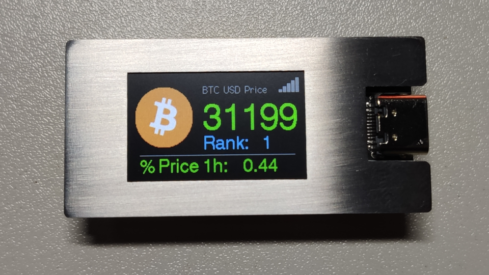
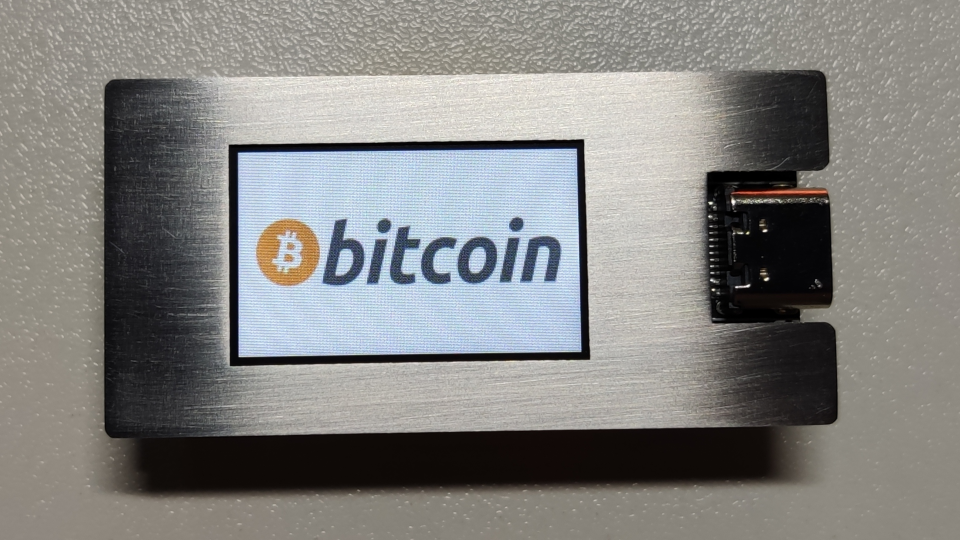

# BTC Price Ticker – TTGO T-Display (ESP32)

A simple Bitcoin price ticker built on the TTGO T-Display (ESP32 with a 1.14" TFT screen). It polls the CoinMarketCap API and shows the current BTC price on the display.

> **Note:** This project uses the CoinMarketCap API **v2**, which requires a free developer key. Make sure you're on the `CoinMarketCapApi2` library and ArduinoJSON 6.x — older setups using the v1 API/library will not work.

## Hardware

- [TTGO T-Display](https://github.com/Xinyuan-LilyGO/TTGO-T-Display) (ESP32, 1.14" TFT)

## Prerequisites

- Arduino IDE
- ESP32 board package **version 1.0.4** (version 1.0.5 is known not to work with this project)
- A free CoinMarketCap API key: <https://pro.coinmarketcap.com/account>

## Setup

### 1. Add ESP32 support to the Arduino IDE

Follow this guide to install the ESP32 board package: <https://randomnerdtutorials.com/installing-the-esp32-board-in-arduino-ide-windows-instructions/>

In the board selector, choose **ESP32 Dev Module** for the TTGO T-Display.

**macOS users:** install the [CP210x USB to UART Bridge VCP driver](https://www.silabs.com/community/interface/knowledge-base.entry.html/2017/01/10/legacy_os_softwarea-bgvU) from Silicon Labs. The correct port is `/dev/cu.SLAB_USBtoUART` (Tools → Port).

### 2. Install the required libraries

Tested with Arduino IDE 1.8.7:

| Library | Notes |
|---|---|
| [TFT_eSPI](https://github.com/Bodmer/TFT_eSPI) | Display driver |
| [CoinMarketCapApi2](https://github.com/lewisxhe/CoinMarketCapApi2) | v2, requires your API key |
| [ArduinoJson](https://github.com/bblanchon/ArduinoJson) | v6.x tested |

Setup instructions for `TFT_eSPI` on the TTGO T-Display: <https://github.com/Xinyuan-LilyGO/TTGO-T-Display>

**Troubleshooting:** If you run into `WiFi.h` conflicts, delete the `arduino/libraries/WiFi` directory and use the ESP32 core's built-in `WiFi.h` instead.

### 3. Flash the sketch

Open the sketch in Arduino IDE, enter your CoinMarketCap API key, select the correct board/port, and upload.

## Enclosure

The `case/` folder contains `.dxf` and `.stp` files for a stainless-steel enclosure, designed to be cut on a laser cutter.

## License

[GPL-3.0](LICENSE)
